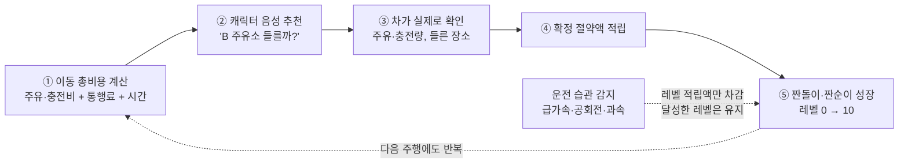

# 짠드라이브 (ZZAN DRIVE)

> 이동에 드는 돈 전체를 계산해 가장 이득인 선택을 캐릭터 음성으로 알려 주고, 차가 직접 확인한 절약액만큼 짠돌이·짠순이를 키우는 차량용 앱

## 공모전 출품 정보

| 항목 | 내용 |
| --- | --- |
| 공모전 | 현대자동차그룹 차량용 앱 개발 공모전 |
| 앱 이름 | 짠드라이브 (ZZAN DRIVE) |
| 플랫폼 | Pleos Connect (Android Automotive 기반) |
| 주제 분야 | 모빌리티 & 라이프 편의, 스마트 드라이빙 |
| 대상 차량 | 내연기관차(하이브리드 포함), 전기차 |
| 패키지 | `com.zzandrive.app` |

공모전 제출 안내가 README에 요구하는 다섯 항목의 위치입니다.

| 필수 항목 | 위치 |
| --- | --- |
| 앱 이름·한 줄 소개 | [맨 위](#짠드라이브-zzan-drive) |
| 실행 방법 | [실행 방법](#실행-방법) |
| 테스트 환경·설정 | [테스트 환경과 설정](#테스트-환경과-설정) |
| 에뮬레이터 버전·화면 규격 | [에뮬레이터 버전과 화면 규격](#에뮬레이터-버전과-화면-규격) |
| APK 위치 | [APK 위치](#apk-위치) |

## 실행 방법

### 1분 안에 보기 (APK만 설치)

1. Pleos Connect Emulator 2.1.0을 켜고 APK를 설치합니다. debug 빌드가 이미 설치되어 있으면 서명이 달라 설치되지 않으므로 먼저 `adb uninstall com.zzandrive.app`을 실행합니다.

   ```bash
   adb install apk/ZZANDRIVE_ZzanDrive_release.apk
   ```

2. 짠드라이브를 열고 캐릭터를 고릅니다. 이어서 위치 권한을 물으면 허용·거부 어느 쪽이든 괜찮습니다.
3. 오른쪽 위 **[시연]** → **[시연 B · 충전]** → **[충전소 찾기]** → 기준 위치 **[현재 위치]** → 충전량 **[40kWh]** → 비교 카드("집 가는 길 B 충전소가 2,323원 이득") → **[응, 들를게]** → 40 kWh 충전 확인, 2,323원 확정, 레벨업 화면(레벨 2 → 3)
4. **[시연]** → **[시연 A · 주유]** → 출발 전 강릉까지 경로 3개 비교(시급 5,000원이면 국도, **[설정]**에서 시급을 **[10,000원]**으로 바꾸면 고속도로) → **[확인]** → 다른 날 휴게소, 연료 10%: 짠돌이가 "기름이 10% 남았어. 얼마나 넣을까?" → **[30L]** → 강릉까지 못 가는 상황이라 주유소를 들르는 경로 3곳을 총 지출로 비교("강릉길 C 주유소가 676원 덜 들어요", 나머지는 −316원·−676원) → **[응, 들를게]** → 30 L 주유 확인, 676원 확정, 정차 후 레벨업 화면(레벨 0 → 1)
5. **[시연]** → **[시연 C · 운전 습관]** → 시동을 켠 채 8분 대기, 급출발·급가속, 과속을 담은 주행이 30초쯤 재생되고, 정차하면 "이번 주행 −377원" 카드가 열립니다. 레벨 적립액은 300원까지만 줄고 누적 절약액은 레벨 1 달성 금액 1,500원에서 멈춥니다.

시연은 Virtual Console 조작 없이 볼 수 있는 시연 데이터로 움직입니다(위쪽 바에 "시연" 표시). **[시연]** → **[실차 모드]**를 누르면 실제 차량 데이터 화면("실차" 표시)으로 돌아갑니다. 캐릭터는 물은 뒤 5초 동안 음성 답을 듣지만, 에뮬레이터는 기본 설정에서 컴퓨터 마이크 소리를 받지 않으므로 화면 버튼으로 답하면 됩니다.

### 실제 차량 데이터로 보기 (macOS)

```bash
./scripts/bootstrap.sh          # 도구 설치 → 에뮬레이터 → 단위 테스트·빌드 → 설치 → 연동 검사 (처음 한 번)
./scripts/demo.sh scenario-b    # [충전소 찾기] → 현재 위치 → 40 kWh → 도로 5 km 안 비교 → 승인·내비 → +40 kWh 충전 → 2,323원 확정 → 레벨 3
./scripts/bootstrap.sh --e2e    # 연동 검사에 이어 시나리오 B를 실제 차량 데이터로 끝까지 자동 확인 (약 2분)
```

- `bootstrap.sh`는 debug 빌드를 설치합니다. `demo.sh`와 E2E 확인이 debug 빌드에만 있는 명령으로 앱을 움직이기 때문입니다. 서명이 다른 release APK가 설치되어 있으면 지우고 설치할지 먼저 묻습니다.
- `demo.sh`는 Virtual Console로 차량 값을 바꾸고, 장면마다 앱 로그로 결과를 확인합니다. 시나리오 10개는 [스크립트](#스크립트)에 있습니다.
- Windows(x86_64)용 `scripts\bootstrap.ps1`도 같은 과정을 진행하도록 만들었지만 실제 Windows PC에서는 확인하지 않았습니다. 실행은 `powershell -ExecutionPolicy Bypass -File scripts\bootstrap.ps1`입니다. `demo.sh`, `e2e-scenario-b.sh`, `release.sh`는 macOS·Linux용 bash 스크립트입니다(Linux에서는 확인하지 않았습니다).

## 테스트 환경과 설정

| 항목 | 내용 |
| --- | --- |
| 호스트 | macOS (Apple Silicon)에서 확인. Linux와 Windows(x86_64)용 `bootstrap.ps1`은 미확인 |
| 에뮬레이터 | Pleos Connect Emulator 2.1.0 ([규격](#에뮬레이터-버전과-화면-규격)) |
| 빌드 | Kotlin 2.0.0, Android Gradle Plugin 8.8.2, Gradle 8.10.2 (wrapper), JDK 17 |
| Android | minSdk 28, compileSdk·targetSdk 35 |
| Pleos SDK | Vehicle 2.3.2, NaviHelper 3.0.5, TextToSpeech 3.3.1, SpeechToText 3.3.1, FusedLocation 1.1.3 |
| 자동 검사 | 단위 테스트 125개, `bootstrap.sh` 연동 검사 11개, `e2e-scenario-b.sh` 검사 12개, `demo.sh` 시나리오 10개 |

### bootstrap.sh가 설치하고 묻는 것

- 순서는 JDK → Android SDK → Pleos 에뮬레이터 이미지 → AVD → 에뮬레이터 실행 → 단위 테스트·빌드 → 설치 → 연동 검사입니다.
- 없는 것은 설치 전에 Y/n으로 묻습니다: JDK 17(macOS는 Homebrew `openjdk@17`), Android SDK 명령줄 도구 20.0(23.0의 `sdkmanager`는 Pleos 이미지 저장소를 보지 못함), SDK 패키지(`platform-tools`, `emulator`, `platforms;android-35`, `build-tools;35.0.0`), Pleos 이미지 저장소 등록, Pleos 에뮬레이터 이미지, AVD. Android Studio는 필요 없습니다.
- 라이선스 동의(Google Android SDK, 42dot Pleos Connect SDK)는 사람이 직접 합니다. 스크립트는 대신 동의하지 않습니다.
- 첫 실행은 이미지 다운로드(약 4.7 GB, 설치 후 약 19 GB)로 시간이 걸리고, SDK가 있는 디스크에 25 GiB 이상 여유가 있어야 합니다. 그다음부터는 2분 안팎입니다.
- 빌드할 때 단위 테스트 125개를 함께 돌립니다. 금액·정산·감지·레벨·추천 분기·경로 비교·주유소 경로 총 지출·운전 습관 차감·대화 흐름·음성 답 해석(예문 491개)·음성 문구·캐릭터 연출 순서를 확인합니다.
- 설치한 뒤 연동 검사 11개를 자동으로 판정하고 `build/bootstrap/report.json`에 남깁니다: Virtual Console 연결과 세션, 앱 실행, Vehicle 값 읽기, 배터리 잔량 왕복(콘솔에서 바꾼 값이 앱에 오는지), NaviHelper, TextToSpeech, SpeechToText, FusedLocation, 주행 제한 상태, 제품 화면의 실제 차량 데이터 수신.
- `--dry-run`을 붙이면 아무것도 설치하지 않고 할 일만 보여 줍니다.

### Virtual Console

- 에뮬레이터의 차량 값은 Virtual Console(`http://127.0.0.1:8088`)에서 바꿉니다. `bootstrap.sh`가 포트를 연결하고 마지막에 브라우저로 엽니다. `scripts/emulator.sh console`로도 열 수 있습니다.
- Virtual Console은 브라우저에 페이지가 열려 있을 때만 값 변경을 받습니다. 스크립트는 브라우저와 같은 연결 신호를 스스로 보냅니다.
- `demo.sh`와 `e2e-scenario-b.sh`는 배터리 잔량(kWh·%), 충전구, 충전 스위치를 바꾸고, 주행 장면에서는 기어와 속도를 바꿉니다. 위치는 에뮬레이터 명령(`adb emu geo fix`)으로 옮깁니다. 앱은 배터리·충전구·충전 스위치·기어를 Pleos Vehicle SDK로, 위치를 FusedLocation으로 읽습니다. 속도는 앱이 읽지 않으며, 시스템이 주행 중 앱 화면을 가리게 하는 데 쓰입니다.
- 끝나면 실패한 경우에도 기어(P), 속도, 배터리, 충전구, 위치를 되돌립니다. `scenario-a`를 뺀 `demo.sh` 시나리오와 E2E 확인은 앱의 절약 기록을 시나리오 시작 상태로 바꿉니다.
- `bootstrap.sh`의 연동 검사는 정차 중일 때 배터리 잔량만 바꿨다가 되돌립니다.

### 위치 권한

- 앱을 처음 열면 실차 모드에서 Pleos 위치 권한(`pleos.car.permission.FUSED_LOCATION`)을 묻습니다. 추천한 충전소·주유소에 들렀는지(또는 그냥 지나쳤는지) 확인하고, '현재 위치' 기준으로 찾을 때 씁니다. 위치는 기기 안에만 저장합니다.
- 허용하지 않아도 시연은 그대로 동작합니다. 실차 모드에서 들른 곳을 확인해 정산하려면 허용해야 합니다.
- 에뮬레이터에서는 권한 창에 '알 수 없는 작업'이라고 나옵니다.
- `bootstrap.sh`는 설치할 때 권한을 미리 허용하고, `release.sh --install`은 권한 없이 설치합니다.

### 마이크와 음성 답

- 캐릭터는 물은 뒤 5초 동안 음성 답을 듣습니다(Pleos SpeechToText, `ON_DEVICE`). 에뮬레이터는 기본 설정에서 컴퓨터 마이크 소리를 받지 않으므로 화면 버튼으로 답합니다.
- `demo.sh scenario-drive`는 실행할 때마다 Mac의 한국어 음성(`say`)으로 "응"을 만들어 SpeechToText에 넣고, 인식 결과로 승인되는지 확인합니다. 이 소리 파일은 저장소에 넣지 않습니다. 넣을 양("40킬로와트시")은 인식 결과 문장을 직접 넣습니다.
- 실제 마이크에서의 인식률은 확인하지 않았습니다.

### 데이터 모드

앱 위쪽 바의 표시가 데이터 출처를 알려 줍니다. "실차"는 실차 모드(차량 값은 Pleos SDK 실측), "시연"은 시연 모드(차량 값은 시연 시계열)입니다. 가격과 도로 거리는 두 모드 모두 예시 데이터입니다. 자세한 구분은 [실제 데이터와 시연 데이터](#실제-데이터와-시연-데이터)에 있습니다.

## 에뮬레이터 버전과 화면 규격

| 항목 | 내용 |
| --- | --- |
| 에뮬레이터 | Pleos Connect Emulator 2.1.0 (AVD 이름 `Pleos_Connect_v2.1.0`) |
| 시스템 이미지 | Android 14 (API 34), 차량용 arm64 이미지(`pleos_car_emulator`, arm64-v8a). x86_64 이미지(Windows·Linux·Intel Mac)는 미확인 |
| 실행 환경 | macOS (Apple Silicon) |
| 화면 | 2560 × 1440 px, 160 dpi (`adb shell wm size`, `adb shell wm density`) |
| 앱 창 | 1682 × 1210 dp (160 dpi라 1 dp = 1 px). 화면 오른쪽, 위쪽 상태 영역과 아래 시스템 바 사이 |
| 차량 | 전기차, 배터리 77.4 kWh |
| AVD 설정 (`bootstrap.sh`가 만들 때) | 기기 프로필 `Pleos_Connect_v2_0`, RAM 4 GB, 콜드 부트 |

화면은 읽지 않고 한눈에 보도록 만들었습니다. 문장 대신 숫자, 원형 그래프, 아이콘을 쓰고, 계산식과 출처 같은 긴 설명은 카드의 ⓘ 버튼 뒤("계산 근거" 팝업)에 둡니다. 글꼴(Asta Sans)·글자 크기·버튼 높이(100·80·64 dp)·팝업 규격(모서리 48 dp)은 Pleos Connect UI 디자인 가이드의 값을 씁니다(캐릭터 위 금액만 가이드의 최대 단계보다 큰 76입니다). 위쪽 바에는 제목과 로고 없이 데이터 출처 표시, 차량 상태 아이콘(정차·주행, 음성 답, 위치 꺼짐), [시연], [설정]만 둡니다.

왼쪽은 캐릭터가 중심입니다. 위에서부터 날짜, "지금까지 아낀 돈"(누적 절약액, 가장 큰 글자), 오늘 손익, 캐릭터, 레벨, 주 버튼 하나([충전소 찾기] 또는 [주유소 찾기])입니다.

오른쪽의 대기 화면은 유리 패널 하나에 놓인 원형 그래프 3개입니다.
- 배터리(연료): 가운데에 잔량(%)과 남은 양, 알림 기준 위치에 금색 눈금. 기준 이하로 내려가면 호와 숫자가 빨강으로 바뀝니다.
- 이번 달: 아낀 금액과 빠진 금액을 나눈 도넛. 가운데에 이번 달 손익.
- 다음 레벨: 다음 음식까지 모은 비율.

원형 그래프 아래에는 앱이 하는 일을 아이콘 세 개로 보여 주는 안내(알림 → 비교 → 적립)가 있습니다. 주행을 마치면 그 자리에 운전 습관 차감을 항목별 도넛(급가속·공회전·과속)과 금액으로 보여 주는 "이번 주행"이 나옵니다(좁은 창에서는 원형 그래프 위). 레벨업은 원형 그래프 위에 따로 나옵니다. 질문·비교·경로 카드가 열리면 대기 화면 대신 그 카드 하나만 보입니다. 목적지가 있을 때의 비교 카드는 최저 대비 손실을 금액과 막대로 함께 보여 줍니다. 그래프 가운데의 숫자가 값을 그대로 보여 주므로, 색만으로 정보를 전하지 않습니다.

색은 현대자동차 CI 색입니다. 글자와 주 버튼은 Hyundai Blue(#002C5F), 알림 기준 눈금은 Hyundai Gold(#A36B4F)입니다. 원형 그래프의 호는 Hyundai Blue에서 시작해 현대 웹 블루(#007FA8)로 끝납니다. Active Blue(#00AAD2)는 밝은 면에서 대비가 낮아 주간 그래프에는 쓰지 않습니다. 이번 달 도넛은 아낀 쪽이 Hyundai Blue, 빠진 쪽이 Active Red(#E63312)입니다. "이번 주행" 도넛은 급가속·공회전·과속을 Active Red·웹 블루·Hyundai Blue로 나눕니다. 이 조합은 적색·녹색 색각 이상 시뮬레이션에서도 서로 구분되는지 계산으로 확인했고(OKLab ΔE 11 이상), 조각 사이를 띄우고 이름과 금액을 옆에 적습니다. 손실 금액은 빨강(주간 #A61616, 야간 #FFA094)입니다. 레벨 표시와 떠다니는 동전은 캐릭터의 번개 노랑입니다.

면은 글래스모피즘으로 그립니다. 바탕은 한 가지 색(주간 #F1F3F6, 야간 #0A1220) 위에 CI 색의 크고 부드러운 빛 덩어리 네 개를 얹은 것이고, 패널·알약 모양 표시·보조 버튼은 그 위의 반투명 유리(주간 흰색 48%, 야간 흰색 8%)입니다. 유리에는 왼쪽 위가 밝은 1.5 dp 테두리와 아래쪽의 부드러운 그림자가 있습니다. 팝업이 열리면 뒤 화면이 흐려집니다(Android 12 이상). 누를 수 있는 것은 그림자가 있고(질문 카드의 [취소]와 비교 카드의 [왜 거기야?]는 글자만 있음), 누르면 유리는 밝아지고 색을 채운 버튼은 어두워지며, 파란 테두리가 생깁니다. 빛 덩어리가 움직여도 읽히도록, 가장 진한 자리를 기준으로 글자 4.5:1 이상, 그래프 3:1 이상의 대비를 계산으로 확인했습니다. 야간에는 Active Blue가 주 색이고 Sky Blue(#AACAE6)가 호의 끝 색이며, 그래프의 빨강·금색은 #F2765F·#C89277로 밝게 씁니다. 주간·야간은 시스템 설정을 따릅니다.

움직임은 정차 중에만 재생합니다(주행 중에는 시스템이 화면을 가립니다). 캐릭터 주위에 동전·번개(주유 차량은 물방울)·비눗방울이 떠 있고, 금액이 바뀌면 숫자가 세어 올라가며, 원형 그래프는 값까지 차오릅니다. 캐릭터가 말하면 음성 막대가 움직이고, 그 문장은 12초 뒤 화면에서 사라집니다. 레벨업 때는 동전이 퍼집니다. 팝업이 열려 있거나 시스템에서 애니메이션을 끄면 캐릭터를 포함해 모두 멈춘 화면으로 보입니다.

앱은 창 크기가 바뀌면(분할 창 등) 화면을 다시 만들지 않고 배치만 바꿉니다. 창 폭이 1200 dp 이상이면 두 단(왼쪽: 날짜·누적 절약액·캐릭터·레벨·[충전소 찾기], 오른쪽: 캐릭터의 말·원형 그래프·카드)으로, 그보다 좁으면(세로 창 840 dp) 위에 날짜·금액·레벨과 작은 캐릭터, 아래에 그래프와 카드를 둡니다.

## APK 위치

`apk/ZZANDRIVE_ZzanDrive_release.apk`

- 공모전 규칙의 `apk/팀명_앱이름_release.apk` 형식입니다.
- 팀 서명 키로 서명한 release 빌드입니다(APK Signature Scheme v2·v3). ABI는 arm64-v8a와 x86_64입니다.
- `scripts/release.sh`가 단위 테스트와 release 빌드를 거쳐 이 위치에 만듭니다. 이때 서명 방식, 인증서(디버그 키나 이메일 주소가 없는지), 디버그 불가 설정, 진단 화면 비공개, 비밀 파일이 들어 있지 않은지, 크기(100 MB 미만)를 확인합니다.
- 설치 방법은 [1분 안에 보기](#1분-안에-보기-apk만-설치)에 있습니다.

---

## 왜 필요한가

운전자는 어디서 주유·충전하고 어느 길로 가야 돈이 덜 드는지 판단할 근거가 없습니다. 내비, 유가 비교, 충전 앱, 연비 기록 앱은 대부분 계산을 도와주는 데서 끝납니다. 짠드라이브는 주유비·충전비, 통행료, 시간을 합쳐 가장 이득인 선택을 먼저 제안합니다. 그리고 실제로 그렇게 했는지 차량 데이터로 확인한 뒤에만 절약액을 쌓아 캐릭터를 키웁니다.

| 운전자의 문제 | 기존 서비스의 한계 | 짠드라이브의 접근 |
| --- | --- | --- |
| 리터당 가격이 싸도 우회 때문에 오히려 손해일 수 있음 | 가격만 보여 주거나, 연비를 직접 입력해야 함 | 우회 비용까지 포함한 **실질 비용** 비교 |
| 전기차 충전 요금이 사업자·속도마다 다름 | 요금 표시에서 끝, 손익 계산 없음 | 우회 비용까지 반영한 충전 손익 계산 |
| 유료·무료 도로 중 어느 쪽이 나은지 계산하기 어려움 | 통행료·연료비는 보여 주지만 주유·충전은 계산에 없음 | 통행료 + 연료비·전기요금 + **시간 가치**를 합쳐 비교하고, 목적지가 있으면 가는 길 주유소를 들르는 경로까지 비교 |
| 운전 중에는 화면을 볼 수 없음 | 직접 조작해야 함 | 앱이 먼저 **음성**으로 제안하고, 운전자는 음성으로 답함 |
| 앱이 보여 주는 절약액이 진짜인지 알 수 없음 | 길안내만 받고 다른 곳에서 넣어도 '절약'으로 쌓임 | **차가 확인한 실제 주유·충전**만 적립 |
| 아껴도 티가 나지 않아 습관이 되지 않음 | 절약을 계속하게 만드는 장치가 없음 | 아낀 돈만큼 **캐릭터가 성장** |

## 세 가지 약속

1. **아끼는 길을 계산합니다.** 주유소·충전소는 우회 비용까지 포함한 실질 비용으로, 경로는 통행료·연료비(전기요금)·시간을 합친 총비용으로 비교합니다.
2. **차가 진짜 절약을 확인합니다.** 실제로 주유·충전했는지, 몇 L·몇 kWh를 넣었는지 차량 데이터로 확인합니다. 쌓이는 금액은 예상치가 아니라 차가 확인한 양으로 다시 계산한 금액입니다(지금 가격은 예시 데이터). 추천 경로로 끝까지 달렸는지 확인하는 기능은 다음 단계입니다.
3. **아낀 만큼 캐릭터가 자랍니다.** 빈 지갑을 털던 캐릭터가 삼각김밥, 짜장면, 한우를 거쳐 킹크랩까지 먹게 됩니다(레벨 0부터 10까지). 들르기로 한 곳을 그냥 지나치면 모은 돈이 깎이지만, 한 번 오른 레벨은 내려가지 않습니다.

## 동작 방식



## 한눈에 보는 예시

금액은 앱의 계산 규칙으로 구합니다([spec.md 11장](spec.md#11-규칙-결정)).

**내연기관차: 어느 주유소가 이득일까?** (기획서 예시 조건: 연비 10 km/L, 50 L 주유, 비교식 [D-24](spec.md#11-규칙-결정). 앱은 기획서 3-1의 공인 연비 15.3 km/L로 계산합니다)

실질 비용 = 넣을 양 × 단가 + 왕복 우회 거리 ÷ 연비 × 단가 + 추가 통행료

| 주유소 | 왕복 우회 | 단가 | 실질 비용 |
| --- | --- | --- | --- |
| A | 2 km | 1,700원/L | 85,000 + 340 = **85,340원** |
| B | 12 km | 1,650원/L | 82,500 + 1,980 = **84,480원** |

더 멀어도 B가 **860원 이득**입니다. 캐릭터는 먼저 넣을 양을 묻고, 비교 결과를 말한 뒤 들를지 묻습니다. 운전자가 "응"이라고 답해야 내비에 B 주유소가 들어갑니다(안내 중이면 경유지로). 이후 차가 주유를 감지하고 실제 주유량으로 절약액을 확정해야 캐릭터 성장에 반영됩니다.

**목적지가 있을 때: 어느 주유소를 들르는 길이 이득일까?** (기획 계산식, [D-32~D-34](spec.md#11-규칙-결정))

총 지출 = 전체 주행 거리 ÷ 연비 × 기준 단가 + 넣을 양 × (주유소 단가 − 기준 단가) + 통행료 + 주행 시간 × 시급

남은 연료로 목적지까지 못 가면 주유소를 들르는 경로만 비교하고, 총 지출이 낮은 3곳을 가장 낮은 곳 0원 기준의 손익으로 보여 줍니다. 아래는 시연 A의 값입니다(공인 연비 15.3 km/L, 기준 단가 1,855.43원/L, 30 L, 시급 5,000원).

| 주유소 | 단가 | 경로 거리 | 통행료 | 주행 시간 | 총 지출 | 최저 대비 |
| --- | --- | --- | --- | --- | --: | --: |
| C (추천) | 1,640원/L | 108 km | 1,000원 | 90분 | 15,134원 | 0원 |
| D | 1,600원/L | 115 km | 0원 | 110분 | 15,450원 | −316원 |
| B | 1,660원/L | 110 km | 0원 | 100분 | 15,810원 | −676원 |
| E | 1,670원/L | 120 km | 0원 | 96분 | 16,989원 | (표시 안 함) |
| A | 1,700원/L | 100 km | 3,000원 | 80분 | 17,131원 | (표시 안 함) |

C를 들르면 보여 준 3곳 중 가장 불리한 B보다 676원 덜 듭니다. 기획서 예시 조건(연비 10 km/L, 기준 단가 1,700원/L)을 넣으면 기획서 표와 같은 25,060원·25,717원·25,833원, 0원·−657원·−773원이 나오고, 단위 테스트로 확인합니다. 목적지까지 갈 수 있으면 "주유 없이 가기"를 같은 식으로 함께 비교해, 들르지 않는 편이 낫다면 그렇게 알려 줍니다.

**경로: 시간과 돈 중 무엇이 이득일까?**

시급을 5,000원으로 두면 30분은 2,500원입니다. 30분 빠른 유료도로가 2,100원 더 들면 유료도로를 추천합니다. 비교값은 운행비 + 걸리는 시간 × 시급이고, 시급은 설정에서 5,000원·1만 원·2만 원 중에 고릅니다. 출발 전 경로 비교의 시간 환산액은 비교에만 쓰고 절약액으로 쌓지 않습니다([D-31](spec.md#11-규칙-결정)). 위의 주유소 경로 비교는 기획 계산식대로 시간비용을 총 지출에 넣고, 확정 절약액도 같은 식(시급은 추천 때 값)으로 계산합니다.

## 주요 기능

| ID | 기능 | 설명 |
| --- | --- | --- |
| F01 | 차량 데이터 수집 | 배터리 잔량·에너지·용량, 충전구, 충전 스위치, 기어, 위치. 연료 잔량·속도·엔진 상태는 시연 데이터. 차량의 전비·연비 조회는 에뮬레이터가 지원하지 않아 기획서 3-1 공인값을 씀 |
| F02 | 주유 손익 계산 | 주유 가격과 우회 비용을 합친 실질 비용 비교, 주유 자동 확인과 확정 정산. 연료 값은 시연 데이터(에뮬레이터에 연료 값 없음) |
| F03 | 충전 손익 계산 | 충전 요금과 우회 비용을 합친 실질 비용 비교, 충전 자동 확인과 확정 정산 |
| F04 | 경로 총비용 비교 | 통행료·연료비(전기요금)·시간 가치로 경로 비교(시연 A의 예시 경로 3개), 목적지가 있을 때 주유소를 들르는 경로의 총 지출 비교(시연 A의 주유소 5곳). 경로 완주 확인과 경로 절약 확정은 다음 단계 |
| F05 | 캐릭터 음성 인터페이스 | 캐릭터별 목소리 안내(TTS), 음성 답("응", "아니", "왜 거기야?", "가까운 데로 가", 양·금액), 경유지 추가 동의 |
| F06 | 캐릭터 성장 | 확정 절약액으로 11단계(레벨 0부터 10까지) 레벨업 |
| F07 | 비효율 주행 패널티 | 급출발·급가속(건당), 공회전(180초 초과분), 과속(제한속도 × 1.1 초과 구간)을 차감하고 주행이 끝날 때 한 번 정산(시연 C, 시연 데이터). 실제 차량 속도·제한속도 연결은 다음 단계 |
| F08 | 월간 손익·짠포인트 | 오늘·이번 달 손익 표시(기회비용 포함). 짠포인트와 쿠폰 교환은 다음 단계 |
| F09 | 향후 확장 | 대화형 캐릭터(LLM), 제휴 리워드, 실차 검증. 공모전 기간에는 LLM SDK가 제공되지 않아 지금 앱에는 없음 |

- 앱은 Vehicle SDK가 배터리 값에 답하면 충전 모드, 연료 값에 답하면 주유 모드로 동작합니다. 에뮬레이터는 전기차라 실제 차량 데이터로는 충전 모드를 확인했고, 주유 모드는 시연 데이터로 보여 줍니다.
- 음성 문구는 앱이 계산한 수치를 정해진 문장에 넣어 만듭니다.

## 캐릭터 성장 시스템

짠돌이와 짠순이 중 하나를 골라 키웁니다. 두 캐릭터는 목소리와 말투가 다르고, 바꿔도 레벨과 금액은 이어집니다.

| 레벨 | 음식 | 달성 금액(누적 절약액) | 다음 레벨까지 |
| :-: | --- | --: | --: |
| 0 | 빈 지갑 | 0원 | 1,500원 |
| 1 | 삼각김밥 | 1,500원 | 2,500원 |
| 2 | 아메리카노 | 4,000원 | 4,000원 |
| 3 | 짜장면 | 8,000원 | 7,000원 |
| 4 | 파스타 | 15,000원 | 11,000원 |
| 5 | 치킨 | 26,000원 | 16,000원 |
| 6 | 족발 | 42,000원 | 24,000원 |
| 7 | 스테이크 | 66,000원 | 34,000원 |
| 8 | 한우 | 100,000원 | 50,000원 |
| 9 | 랍스터 | 150,000원 | 100,000원 |
| 10 | 킹크랩 | 250,000원 | — (최고 레벨) |

> 금액 기준은 시연과 사용자 테스트 후 조정될 수 있습니다.

규칙:

- **확정 절약액**이 생기면 *레벨 적립액*이 늘고, 목표액을 채우면 레벨이 오릅니다. 넘친 금액은 다음 레벨로 이월되고, 한 번에 여러 레벨을 넘으면 차례로 오릅니다. 레벨 10 이후에도 금액은 계속 쌓입니다.
- 차감(들르기로 한 곳을 그냥 지나친 기회비용, 운전 습관)은 *레벨 적립액에서만* 뺍니다. 적립액은 0원 밑으로 내려가지 않고, **이미 달성한 레벨과 그 레벨의 달성 금액 아래로 누적 절약액은 내려가지 않습니다.** 화면 위쪽의 큰 금액이 이 누적 절약액입니다.
- **이번 달 손익**(= 확정 절약액 − 차감액 전체)은 따로 계산합니다. 마이너스가 될 수 있고 화면에 그대로 보여 줍니다. 짠포인트(이번 달 손익이 양수일 때 일부를 적립해 쿠폰으로 교환)는 다음 단계입니다.

| 용어 | 뜻 | 예시 (레벨 2) |
| --- | --- | --- |
| 레벨 달성 금액 | 그 레벨에 도달하는 데 필요한 누적 절약액 (줄지 않음) | 4,000원 |
| 레벨 적립액 | 현재 레벨 달성 후 새로 모은 금액 (차감은 여기서만) | 1,000원 |
| 누적 절약액 | 레벨 달성 금액 + 레벨 적립액 | 5,000원 |
| 레벨업까지 남은 금액 | 레벨업 목표액 − 레벨 적립액 | 4,000 − 1,000 = 3,000원 |

캐릭터는 팀이 3D로 렌더링한 투명 애니메이션 WebP(720×720, 24fps)입니다. 짠돌이는 대기, 삼각김밥(레벨 1)·짜장면(레벨 3) 먹기와 들고 대기, 레벨업, 기쁨, 시무룩 동작이 있습니다. 레벨업은 같은 자리에서 레벨업 → 새 음식 먹기 → 들고 대기로 이어집니다. 짠순이 그림과 나머지 레벨의 동작은 다음 단계이며, 그동안 짠순이를 고르면 짠돌이 그림에 "그림 준비 중"을 함께 표시합니다.

## 사용 시나리오

기획서의 두 시나리오를 앱이 진행하는 방식입니다. 금액은 앱의 계산 규칙과 예시 데이터로 구한 값입니다.

**A. 내연기관차 가족 여행 (서울 → 강릉)**: 짠돌이, 레벨 0, 적립액 1,000원. 앱의 [시연 A · 주유] 또는 `demo.sh scenario-a`

1. 출발 전: 강릉까지 예시 경로 3개(고속도로·국도·혼합)를 운행비(고속도로를 지나는 경로만 통행료 포함: 고속도로 10,000원, 혼합 5,000원)와 걸리는 시간 × 시급으로 비교합니다. "국도가 고속도로보다 70분 느리지만 약 7,600원 덜 들어. 시급 5,000원으로 치면 국도가 나아!" 시급을 1만 원으로 바꾸면 고속도로를 추천합니다. 경로 절약액은 쌓지 않습니다.
2. 다른 날, 강릉까지 100 km 남은 휴게소: 연료가 10%로 알림 기준(기본 20%) 아래라서 짠돌이가 먼저 "기름이 10% 남았어. 얼마나 넣을까?"라고 묻습니다. → 30 L
3. 주행 가능 거리는 (남은 6 L − 안전 여유 0.6 L) × 15.3 km/L = 82.6 km라 목적지까지 못 갑니다([D-33](spec.md#11-규칙-결정)). 그래서 갈 수 있는 주유소 5곳을 들르는 경로의 총 지출을 비교하고 낮은 3곳을 보여 줍니다(위 [예시](#한눈에-보는-예시)의 표). "이대로는 목적지까지 못 가. 시간까지 치면 강릉길 C 주유소가 약 680원 덜 들어. 들를까?" → "응"
4. 주유: 차가 30 L 주유를 감지하고, 같은 식에 실제 주유량을 넣어 676원을 확정합니다(보여 준 3곳 중 가장 불리한 B 대비, [D-29](spec.md#11-규칙-결정)). 주행 중에는 "약 680원 아꼈어!" 한 줄만 말하고, 정차한 뒤 레벨업 화면을 보여 줍니다(레벨 1, 넘친 176원 이월).

목적지까지 갈 수 있을 때 "주유 없이 가기"와 함께 비교하는 경우와 경로 안내 중에 찾기를 요청하는 경우는 계산·단위 테스트·화면 처리까지 있고, 시연 장면은 다음 단계입니다. 월말 짠포인트도 다음 단계입니다.

**B. 전기차 출퇴근**: 짠순이, 레벨 2, 적립액 3,000원. 앱의 [시연 B · 충전] 또는 `demo.sh scenario-b`

1. 정차 중 [충전소 찾기]를 누릅니다. 서드파티 앱은 차량 호출어로 직접 부를 수 없고 Gleo 연동 승인은 공모전 기간에 받을 수 없어, 화면 버튼으로 시작합니다. "어디 근처로 찾을래?" → [현재 위치]
2. "얼마나 충전할래?" → [40kWh]. 기준 위치에서 도로 5 km 안의 충전소끼리 비교하고, 도로 6.2 km인 1곳은 뺍니다([D-26](spec.md#11-규칙-결정)). "회사 앞 충전소보다 집 가는 길 B 충전소가 약 2,300원 이득이야. 들를래?" → "응"
3. 충전: 정차 중 충전구가 열리거나 충전이 켜지고 배터리 에너지가 늘면 충전으로 감지합니다. 들른 곳이 추천한 충전소인지 위치(300 m 안)로 확인하고, 40 kWh로 2,323원을 확정합니다(공인 전비 6.0 km/kWh). 레벨 3이 되고 "짜장면 레벨 달성! 파스타까지 약 5,700원 남았어"라고 말합니다.
4. 다른 경우: 5 km 안에 충전소가 없으면 가장 가까운 1곳만 안내하고(`scenario-b-far`), 양을 건너뛰면 거리만 비교합니다(`scenario-b-skip`). 이 두 경우는 절약액을 쌓지 않습니다. 배터리가 알림 기준(기본 25%)에 닿으면 앱이 먼저 양을 묻고(`scenario-b-auto`), 승인한 곳을 충전 없이 지나치면 기회비용을 뺍니다(`scenario-pass`, [D-28](spec.md#11-규칙-결정)).

**C. 운전 습관 (시연 데이터)**: 짠돌이, 레벨 1, 적립액 300원(누적 1,800원). 앱의 [시연] → [시연 C · 운전 습관] 또는 `demo.sh scenario-habit`

1. 시동을 켠 채 기어 P로 8분: 180초를 넘으면 "시동 켠 채로 3분 넘었어. 기름이 새고 있어!" 그 뒤 5분이 공회전으로 계산됩니다(94원, [D-36](spec.md#11-규칙-결정)).
2. 출발하며 1초에 14 km/h(급출발), 시속 40에서 1초에 10 km/h(급가속): 한국교통안전공단 운행기록분석시스템의 택시 기준이고, 한 번의 가속은 1건, 건당 공격적 주행 1 km만큼(136원)입니다([D-35](spec.md#11-규칙-결정)). 주행 중에는 금액 없이 "어이쿠, 살살 밟자!" 한 줄만 말합니다. 급제동은 기록만 합니다.
3. 제한 100 km/h 도로(예시 데이터)를 125 km/h로 6.25 km: 평가 속도 110 km/h를 넘은 15 km/h만큼 11원([D-37](spec.md#11-규칙-결정)). "조금만 천천히 가자!"
4. 정차하고 시동을 끄면 한 번 정산합니다: 272원 + 94원 + 11원 = 377원. 레벨 적립액은 300원까지만 줄고 누적 절약액은 레벨 1 달성 금액 1,500원에서 멈춥니다. 이번 달 손익에는 −377원 전부를 반영합니다. "앗, 급가속, 공회전, 과속 때문에 이번 레벨 적립액이 다 줄었어…"

## 안전 설계

| 상황 | 화면 | 음성 |
| --- | --- | --- |
| 주행 중 | 시스템이 앱 화면을 가림("주행 중에는 사용할 수 없습니다"). 조작할 것이 없음 | 한두 문장의 짧은 질문. 물은 뒤 5초 동안 음성 답을 들음("왜 거기야?"에는 한 줄로 이유를 답함). 음성 답을 끄면 질문 없이 한 줄만 말하고, 정차하면 화면에서 물음 |
| 정차·주차 중 | 캐릭터 애니메이션, 레벨업 연출, 오늘·이번 달 손익, 질문·비교 카드 | 질문과 이유 설명(비교 카드의 [왜 거기야?] 버튼으로도 들음) |

- 화면이 가려진 동안에도 차량 값 수신, 추천, 음성 안내는 계속됩니다.
- 경유지 추가와 경로 변경은 운전자가 "응"(음성 또는 화면 버튼)으로 동의한 뒤에만 실행합니다. "응"은 답 전체가 동의일 때만 받습니다. "어디야?" 같은 질문이나 "그냥 갈게" 같은 거절은 동의가 아닙니다.
- 답이 없으면 아무것도 실행하지 않고, 알아듣지 못하면 한 번만 다시 묻습니다. 주행 중에 답하지 못한 추천은 정차한 뒤 한 번 더 묻습니다.
- 캐릭터는 오디오 포커스를 받은 뒤에만 말하고, 받지 못하면 그 문장을 건너뜁니다. 말하는 중에 포커스를 잃으면 멈춥니다.
- 레벨업 화면과 캐릭터 애니메이션은 정차 중(기어 P)에만 보여 줍니다. 주행 중에 오른 레벨은 정차한 뒤 보여 줍니다.
- 레벨은 내려가지 않습니다. 차감은 레벨 적립액에서만 하고 0원 아래로 내리지 않습니다.
- 급제동은 차감하지 않습니다. 위험을 피하는 정상 행동일 수 있기 때문입니다.
- 운전 습관은 주행 중에 금액 없이 짧은 한 줄로만 알립니다(1분에 한 번 이하, 질문 중에는 말하지 않음). 금액과 내역은 정차한 뒤 한 번 보여 줍니다. 고속도로 합류 같은 필요한 가속을 고려한 민감도 설정은 실제 차량 속도를 연결하는 다음 단계에서 정합니다.

## 실제 데이터와 시연 데이터

| 항목 | 실차 모드 ("실차" 표시) | 시연 모드 ("시연" 표시) |
| --- | --- | --- |
| 배터리 잔량·에너지·충전구·충전 스위치·기어 | Pleos Vehicle SDK 실측 (에뮬레이터에서는 Virtual Console로 값을 바꿈) | 시연 시계열 |
| 연료 잔량(주유) | 받을 수 없음: 에뮬레이터 이미지가 전기차라 Vehicle SDK가 연료 값을 주지 않음 | 시연 시계열 |
| 위치 | Pleos FusedLocation | 시연 좌표 |
| 속도·엔진 상태·도로 제한속도(운전 습관) | 읽지 않음: Vehicle SDK에 속도 API가 없어 운전 습관은 평가하지 않음 | 시연 시계열(제한속도는 예시 데이터) |
| 연비·전비 | 기획서 3-1 공인값(휘발유 15.3 km/L, 경유 14.3 km/L, 전기 6.0 km/kWh). Vehicle SDK의 전비·연비 조회는 에뮬레이터에서 지원하지 않음(진단 화면에 표시) | 같음 |
| 추천 장소 안내 | Pleos NaviHelper `requestRoute` (안내 중이면 `addWaypoint`로 경유지 추가) | 기록만 |
| 음성 안내 | Pleos TextToSpeech (`ON_DEVICE`, 짠돌이·짠순이 목소리 다름, 오디오 포커스를 받은 뒤에만 말함) | 같음 |
| 음성 답 | Pleos SpeechToText (`ON_DEVICE`, 앱이 물은 뒤 5초) | 같음 |
| 주유소·충전소 가격, 도로 거리, 저장한 장소, 목적지까지 남은 거리, 주유소를 들르는 경로 | 예시 데이터 (충전 A 350·B 290원/kWh, 강릉길 주유소 5곳은 기획 계산식의 예시 등. 위쪽 바에 예시라고 표시) | 같음 |
| 계산·정산·레벨 | 앱 계산 (`core`) | 같음 |

- 시연 A는 기획서 시나리오 A의 목적지까지 못 가는 경우를 시작 상태(레벨 0·적립 1,000원·짠돌이)에 적용하고, 휴게소 장면의 주유소 5곳에 기획 계산식의 예시(단가·경로 거리·통행료·시간)를 넣은 것입니다.
- 시연 C는 한 번의 주행(약 14분)을 시각을 붙인 표본으로 30초에 재생합니다. 금액은 표본의 시각으로 계산하므로 재생 속도와 상관없이 같습니다.
- 에뮬레이터 2.1.0의 내비는 거리와 시간을 고정값으로 돌려줍니다. 그래서 추천 장소를 내비에 넘기는 것까지 확인했고, 실제 경로 계산은 확인할 수 없습니다. 안내 중 경유지 추가(`addWaypoint`)는 에뮬레이터에서 아직 확인하지 않았습니다.
- 실제 가격·도로 거리 API(오피넷, 충전 요금, 길찾기)는 아직 연결하지 않았고, 사용 가능 여부도 확인하지 않았습니다. 연결 전까지 화면의 가격·거리에는 "예시 데이터"라고 표시합니다.

## 구현 범위

✅ 앱에서 동작 · 🟡 일부만 동작 · ⬜ 앱에는 아직 없음. 가격·도로 거리·경로는 어느 경우든 예시 데이터입니다. 기능별 상세는 [spec.md 1장](spec.md#1-구현-범위)에 있습니다. spec.md는 같은 아이콘을 데이터 출처 기준(✅ 실제 차량 데이터, 🟡 시연·예시 데이터)으로 씁니다.

| 기획서 기능 | 현재 구현 | 다음 단계 |
| --- | --- | --- |
| 3-1 추천 시작: 잔량이 기준 아래 | ✅ 기준 %를 설정에서 10%부터 40%까지 조절(기본 전기차 25%·주유 20%). 차량 경고등 신호는 일반 앱 권한으로 읽을 수 없어 설정값을 씀 | — |
| 3-1-1 목적지 없음: 기준 위치(현재·저장한 곳) → 넣을 양·금액 → 도로 5 km 안 후보 비교, 없으면 가장 가까운 1곳, 답이 없으면 거리만 | ✅ 위치·거리·가격은 예시 데이터 | 실제 가격·길찾기 API, 충전 시간 반영 |
| 3-1-1 목적지 있음: 주행 가능 거리 = (잔량 − 안전 여유) × 연비로 분기. 못 가면 주유소를 들르는 경로만 총 지출로 비교해 3곳, 갈 수 있으면 "주유 없이 가기"도 함께. 경로상 요청은 최저 단가 1곳 | 🟡 시연 A에서 못 가는 경우(주유소 5곳 중 3곳 표시)를 볼 수 있음. 경로·주유소는 예시 데이터. 갈 수 있는 경우와 경로상 요청은 계산·단위 테스트·화면 처리까지 | 실제 경로·길찾기 API |
| 3-1 충전 자동 확인 → 확정 정산 | ✅ 실제 차량 데이터 | — |
| 3-1 주유 자동 확인 → 확정 정산 | ✅ 시연 데이터 (에뮬레이터에 연료 값 없음) | 내연기관 차량의 연료 값 연결 |
| 3-1 들르기로 한 곳을 그냥 지나침 → 기회비용 차감 | ✅ 추천 장소 300 m 안에 들어왔다가 넣지 않고 500 m 밖으로 나가면 1회 (`demo.sh scenario-pass`) | — |
| 3-2 출발 전 경로별 비용·시간 비교 | 🟡 시연 A: 예시 경로 3개를 운행비(고속도로를 지나는 경로만 통행료 포함) + 시간 × 시급으로 비교. 시급은 설정(5,000원·1만 원·2만 원). 출발 전 경로 절약액은 쌓지 않음 | 경로 API, 경로 절약 확정 |
| 3-3 캐릭터 음성 안내, 캐릭터 선택 | ✅ 짠돌이·짠순이 목소리가 다름, 오디오 포커스를 받은 뒤에만 말함 | — |
| 3-3 음성 답 | ✅ 앱이 물은 뒤 5초: "응", "아니", "왜 거기야?", "가까운 데로 가", 양·금액("가득", "40킬로와트시", "1만 5천 원"). 주행 중에도 음성으로 묻고 답을 받음(설정에서 끄면 정차 후 화면에서). 주행 중 양을 답하지 않으면 거리만 비교. "응"은 답 전체가 동의일 때만 받음 | 실제 마이크로 인식률 확인 |
| 3-4 레벨과 레벨업 연출(정차 후에만) | ✅ 레벨 0부터 10까지 레벨업 화면과 음성. 짠돌이 애니메이션: 대기, 삼각김밥(레벨 1)·짜장면(레벨 3) 먹기와 들고 대기, 레벨업, 기쁨, 시무룩 | 짠순이 그림, 나머지 레벨 애니메이션 |
| 6 안전: 주행 중 화면 제한, 음성만 | ✅ 주행 중에는 시스템이 화면을 가리고 음성으로만 묻고 답함 (`demo.sh scenario-drive`) | — |
| 비효율 주행 패널티(급가속·공회전·과속) | 🟡 판정·차감·주행 끝 정산과 화면·음성이 시연 데이터로 동작(`demo.sh scenario-habit`). 레벨 적립액은 0원까지, 누적 절약액은 레벨 달성 금액까지만 줄어듦 | 실제 차량 속도·제한속도 연결, 민감도 설정 |
| 월간 손익·짠포인트 | 🟡 오늘·이번 달 손익 표시(기회비용 포함) | 짠포인트·쿠폰 교환 |

## 사용 기술

| 용도 | 지금 쓰는 것 | 다음 단계 후보 |
| --- | --- | --- |
| 차량 데이터 | Pleos Vehicle SDK 2.3.2 (배터리 잔량·에너지·용량, 충전구, 충전 스위치, 기어) | 속도: AAOS 차량 속성 `PERF_VEHICLE_SPEED` (Vehicle SDK에는 속도 API가 없음). 도로 제한속도: NaviHelper `onCurrentRoadSpeedLimit`. 실측 연비·전비: Vehicle SDK의 연비·전비 API(에뮬레이터 2.1.0은 미지원) |
| 위치·내비 | Pleos FusedLocation 1.1.3, NaviHelper 3.0.5 (`requestRoute`로 추천 장소 안내, 안내 중이면 `addWaypoint`로 경유지 추가. 에뮬레이터에서 경유지 추가는 아직 확인하지 않음) | 경로 옵션 |
| 음성 | Pleos TextToSpeech 3.3.1 (`ON_DEVICE`, 캐릭터별 `setSpeakerType`, 오디오 포커스), SpeechToText 3.3.1 (`ON_DEVICE`, 앱이 물은 뒤 5초) | 대화형 캐릭터(LLM)와 Gleo 연동은 향후 계획. 공모전 기간에는 LLM SDK가 제공되지 않고 Gleo 앱 스키마 승인을 받을 수 없음 |
| 가격·충전소·도로 거리 | 예시 데이터 (위쪽 바에 예시라고 표시) | 오피넷 유가정보 API, 한국환경공단 전기자동차 충전소 정보 API, 충전사업자 공시 요금 |
| 경로·통행료 | 시연 A의 경로 3개·목적지·남은 거리는 예시 데이터 | 네이버 지도 Directions API 또는 카카오모빌리티/T 맵 길찾기 API, 한국도로공사 공공데이터 |

> 외부 API 후보(오피넷, 충전소 정보, 충전 요금, 길찾기, 한국도로공사)와 AAOS 속도 속성은 아직 연결하지 않았고 사용 가능 여부도 확인하지 않았습니다. Odometer는 에뮬레이터에서 값을 읽을 수 있습니다. Vehicle SDK의 전비·연비 조회 8가지는 에뮬레이터 2.1.0에서 모두 "지원하지 않음"으로 답해 기획서 3-1 공인값을 씁니다. 연동 상태는 [spec.md 9장](spec.md#9-외부-연동)에 있습니다.

## 프로젝트 구조

| 모듈 | 하는 일 |
| --- | --- |
| [`app`](app/README.md) | 화면, 음성(TTS·STT), 캐릭터 연출. 실차·시연 런타임을 Activity가 아닌 Application에 두어, 주행 중 화면이 가려져도 감지·정산·음성이 계속됨 |
| [`core`](core/README.md) | 계산·추천·정산·감지·레벨·대화 흐름·음성 답 해석·음성 문구. 순수 Kotlin(JVM)이라 에뮬레이터 없이 단위 테스트 |
| [`data:source-api`](data/README.md) | 차량·위치·장소·가격·경로 데이터의 인터페이스와 데이터 출처 표시 |
| [`data:source-mock`](data/README.md) | 시연 데이터: 차량 값 시계열 재생, 예시 장소·가격·경로 |
| [`data:source-pleos`](data/README.md) | Pleos Vehicle SDK·FusedLocation·NaviHelper 연동 |

규칙, 산식, 상태 전이, 테스트 벡터는 [spec.md](spec.md)에 있습니다.

## 스크립트

| 스크립트 | 하는 일 |
| --- | --- |
| `scripts/bootstrap.sh` (Windows: `bootstrap.ps1`, 미확인) | 도구 설치부터 빌드·설치·연동 검사까지 한 번에. `--dry-run`: 할 일만 출력, `--e2e`: 시나리오 B 실데이터 확인까지 |
| `scripts/demo.sh 시나리오` | 기획서 시나리오를 장면별 자막과 함께 진행하고 앱 로그로 확인 (`--step` 발표용, `--tap` 화면 버튼으로 승인, `--record` 녹화). 시나리오는 아래 표 |
| `scripts/e2e-scenario-b.sh` | 시나리오 B를 실제 차량 데이터로 끝까지 자동 확인(검사 12개). 앱을 다시 켜도 두 번 적립하지 않는지도 확인 |
| `scripts/release.sh` | release APK 빌드·서명 확인·내용 검사 후 `apk/`에 저장 (`--install`: 권한 없이 설치) |
| `scripts/emulator.sh` | 에뮬레이터 시작·중지·상태 확인, Virtual Console 열기 |

`bootstrap.sh`의 연동 검사는 `scripts/verify-app.sh`가 합니다. `demo.sh`, `e2e-scenario-b.sh`, `release.sh`는 macOS·Linux용입니다(Linux 미확인).

| `demo.sh` 시나리오 | 보여 주는 것 |
| --- | --- |
| `scenario-b` | [충전소 찾기] → 현재 위치 → 40 kWh → 도로 5 km 안 비교(6.2 km 1곳 제외) → 승인 → 충전 → 2,323원 → 레벨 3 |
| `scenario-b-far` | 본가 근처: 5 km 안에 충전소가 없어 가장 가까운 1곳만 안내(비교·적립 없음) |
| `scenario-b-skip` | 넣을 양을 건너뜀: 거리만 비교, 충전해도 적립하지 않는 이유를 말함 |
| `scenario-b-auto` | 정차 중 배터리가 기준(25%)에 닿음: 앱이 먼저 양을 묻고 추천 |
| `scenario-pass` | 승인한 B를 충전 없이 지나침: 정차 후 "77원 뺐어", 다음 기준 도달에 다시 추천 |
| `scenario-a` | 출발 전 경로 3개 비교(예시) → 휴게소: 강릉까지 못 가는 경우 → 주유소를 들르는 경로 3곳 총 지출 비교(0원·−316원·−676원) → 30 L → 676원 → 레벨 1 (시연 데이터) |
| `scenario-habit` | 공회전 8분, 급출발·급가속 2건, 과속 6.25 km → 주행 끝에 377원 한 번 차감 → 레벨 적립액 300원까지만 줄고 누적 1,500원 유지 (시연 데이터) |
| `scenario-drive` | 주행 중: 화면이 가려진 채 음성으로 양을 묻고, "응"을 SpeechToText로 알아듣고 승인 |
| `scenario-drive-quiet` | 음성 답을 끈 주행: 질문 없이 한 줄만, 정차하면 화면에서 묻기 |
| `scenario-levels` | 레벨 0부터 10까지 레벨업 화면과 음성을 차례로 |

## 오픈소스 고지

앱의 [설정] → [오픈소스 고지]에서도 볼 수 있습니다([목록](app/src/main/assets/open_source_notices.txt)).

| 구성 요소 | 라이선스 |
| --- | --- |
| Pleos Connect SDK(Vehicle, NaviHelper, TextToSpeech, SpeechToText, FusedLocation)와 함께 들어가는 모듈 | 42dot Pleos Connect SDK 라이선스 (약관 동의 후 사용) |
| AndroidX, Material Components, Dagger·Hilt, Gson, Tink, Guava ListenableFuture, Error Prone annotations, JSR 305, javax.inject | Apache License 2.0 |
| Kotlin 표준 라이브러리, kotlin-reflect, kotlinx.coroutines, kotlinx.serialization, JetBrains annotations | Apache License 2.0 |
| JNA | Apache License 2.0 (LGPL 2.1과의 이중 라이선스 중 선택) |

라이선스 이름은 release 빌드에 들어가는 라이브러리의 POM 파일에 적힌 값입니다.
