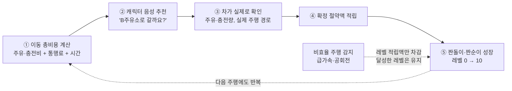

# 짠드라이브 (ZZAN DRIVE)

> 이동에 드는 돈 전체를 계산해 가장 이득인 선택을 **캐릭터 음성**으로 알려주고,
> **차가 직접 확인한 절약액**만큼 짠돌이·짠순이를 키우는 차량용 앱

| 항목 | 내용 |
| --- | --- |
| 플랫폼 | Pleos Connect (Android Automotive 기반) |
| 대상 차량 | 내연기관차(하이브리드 포함), 전기차 |
| 주제 분야 | 모빌리티 & 라이프 편의, 스마트 드라이빙 |
| 현재 상태 | **기획 단계** (구현된 코드 없음) — 아래 [현재 상태](#10-현재-상태) 참고 |
| 원본 | 짠드라이브 최종 기획서 (2026-11-05, @Ella) |

> 구현 담당자와 AI 에이전트는 이 문서를 읽은 뒤 [spec.md](spec.md)를 확인하세요.

---

## 1. 한 줄 요약

운전자는 "어디서 주유·충전하고, 어느 길로 가야 돈이 덜 드는지" 판단할 근거가 없습니다.
짠드라이브는 **주유비·충전비, 통행료, 시간**을 합쳐 가장 이득인 선택을 먼저 제안합니다.
그리고 실제로 그렇게 했는지 **차량 데이터로 확인한 뒤에만** 절약액을 쌓아 캐릭터를 키웁니다.

## 2. 왜 필요한가

기존 서비스(내비, 유가 비교, 충전 앱, 연비 기록 앱)는 대부분 "계산을 도와주는 데서" 끝납니다.

| 운전자의 문제 | 기존 서비스의 한계 | 짠드라이브의 접근 |
| --- | --- | --- |
| 리터당 가격이 싸도 우회 때문에 오히려 손해일 수 있음 | 가격만 보여주거나, 연비를 직접 입력해야 함 | 우회 비용까지 포함한 **실질 비용** 비교, 연비는 차의 **실측값** 사용 |
| 전기차 충전 요금이 사업자·속도마다 다름 | 요금 표시에서 끝, 손익 계산 없음 | 우회·전비·충전 시간까지 반영한 손익 계산 |
| 유료/무료 도로 중 뭐가 나은지 계산하기 어려움 | 통행료·연료비는 보여주나 주유·충전은 계산에 없음 | 통행료 + 연료·전기요금 + **시간 가치**를 합쳐 비교 |
| 운전 중에는 화면을 볼 수 없음 | 직접 조작이 필요 | 앱이 먼저 **음성**으로 제안하고, 음성으로 답함 |
| 앱이 보여주는 절약액이 진짜인지 알 수 없음 | 길안내만 받고 다른 곳에서 넣어도 '절약'으로 쌓임 | **실제 주유·충전·주행을 확인**한 금액만 적립 |
| 아껴도 티가 나지 않아 습관이 안 감 | 절약을 계속하게 만드는 장치 없음 | 아낀 돈만큼 **캐릭터가 성장** |

## 3. 세 가지 약속

1. **아끼는 길을 계산합니다.** 주유소·충전소는 우회 비용까지 포함한 실질 비용으로, 경로는 통행료·연료비(전기요금)·시간을 합친 총비용으로 비교합니다.
2. **차가 진짜 절약을 확인합니다.** 실제로 주유·충전했는지, 몇 L·몇 kWh를 넣었는지, 추천 경로로 달렸는지를 차량 데이터로 확인합니다. 쌓이는 금액은 예상치가 아니라 **실제로 아낀 돈**입니다.
3. **아낀 만큼 캐릭터가 자랍니다.** 빈 지갑을 털던 캐릭터가 삼각김밥, 짜장면, 한우를 거쳐 킹크랩까지 먹게 됩니다(레벨 0~10). 급가속을 하면 모은 돈이 깎이지만, **한 번 오른 레벨은 내려가지 않습니다.**

## 4. 동작 방식

### 한눈에 보는 예시

**내연기관차 — 어느 주유소가 이득일까?** (연비 10km/L, 50L 주유)

| 주유소 | 왕복 우회 | 단가 | 실질 비용 |
| --- | --- | --- | --- |
| A | 2km | 1,700원/L | 85,000 + 340 = **85,340원** |
| B | 12km | 1,650원/L | 82,500 + 1,980 = **84,480원** |

→ 더 멀어도 B가 약 **860원 이득**. 캐릭터가 "B 주유소로 갈까?"라고 묻고, 운전자가 "응"이라고 답하면 경유지가 추가됩니다.
이후 차가 주유를 감지하고 실제 주유량으로 절약액을 **확정**해야 캐릭터 성장에 반영됩니다.

**경로 — 시간과 돈 중 무엇이 이득일까?**
"1시간을 아끼는 데 5,000원까지 쓸 수 있다"고 정해두면, 30분 빠른 유료도로가 2,100원 더 들 때
(30분 = 2,500원 기준 안) 유료도로를 추천합니다.

## 5. 주요 기능

| ID | 기능 | 설명 |
| --- | --- | --- |
| F01 | 차량 데이터 수집 | 차종·연료 종류, 연료/배터리 잔량, 속도, 위치, 실측 연비·전비 |
| F02 | 주유 손익 계산 | 주유 가격 + 우회 비용 통합 비교, 주유 자동 확인 |
| F03 | 충전 손익 계산 | 충전 요금 + 우회 + 충전 시간 비교, 충전 자동 확인 |
| F04 | 경로 총비용 비교 | 통행료·연료비·전기요금·시간 가치, 추천 경로 완주 확인 |
| F05 | 캐릭터 음성 인터페이스 | TTS 안내, STT 명령("응", "왜 거기야?"), 경로 변경 승인 |
| F06 | 캐릭터 성장 | 확정 절약액으로 11단계 레벨업 |
| F07 | 비효율 주행 패널티 | 급가속·공회전 감지, 주행 후 정산 |
| F08 | 월간 손익·짠포인트 | 이번 달 손익 정산, 포인트 → 쿠폰 교환 |
| F09 | 확장 기능 | LLM 대화형 캐릭터, 제휴 리워드, 실차 검증 |

차량의 연료 종류를 읽어 **내연기관차는 주유 모드, 전기차는 충전 모드**로 자동 전환됩니다.

## 6. 캐릭터 성장 시스템

짠돌이와 짠순이 중 하나를 골라 키웁니다(목소리·말투가 다르고, 바꿔도 레벨과 금액은 이어집니다).

| 레벨 | 음식 | 달성 금액(누적 절약액) | 다음 레벨까지 |
| :-: | --- | --: | --: |
| 0 | 빈 지갑 | 0원 | 1,500원 |
| 1 | 삼각김밥 | 1,500원 | 2,500원 |
| 2 | 아메리카노 | 4,000원 | 4,000원 |
| 3 | 짜장면 | 8,000원 | 7,000원 |
| 4 | 파스타 | 15,000원 | 11,000원 |
| 5 | 치킨 | 26,000원 | 16,000원 |
| 6 | 족발 | 42,000원 | 24,000원 |
| 7 | 스테이크 | 66,000원 | 34,000원 |
| 8 | 한우 | 100,000원 | 50,000원 |
| 9 | 랍스터 | 150,000원 | 100,000원 |
| 10 | 킹크랩 | 250,000원 | — (최고 레벨) |

> 금액 기준은 시연과 사용자 테스트 후 조정될 수 있습니다.

핵심 규칙:

- **확정 절약액**이 생기면 *레벨 적립액*이 늘고, 목표액을 채우면 레벨이 오릅니다. 넘친 금액은 다음 레벨로 이월됩니다.
- **비효율 주행**을 하면 낭비한 금액만큼 *레벨 적립액에서만* 차감됩니다. 적립액은 0원 밑으로 내려가지 않고, **이미 달성한 레벨은 내려가지 않습니다.**
- 실제 보상은 별도로 계산하는 **이번 달 손익**(= 확정 절약액 − 비효율 차감액 전체)입니다. 이 값은 마이너스가 될 수 있고, 양수일 때만 **짠포인트**가 적립되어 쿠폰으로 바꿀 수 있습니다.

| 용어 | 뜻 | 예시 (레벨 2) |
| --- | --- | --- |
| 레벨 달성 금액 | 그 레벨에 도달하는 데 필요한 누적 절약액 (줄지 않음) | 4,000원 |
| 레벨 적립액 | 현재 레벨 달성 후 새로 모은 금액 (패널티는 여기서만 차감) | 1,000원 |
| 누적 절약액 | 레벨 달성 금액 + 레벨 적립액 | 5,000원 |
| 레벨업까지 남은 금액 | 레벨업 목표액 − 레벨 적립액 | 4,000 − 1,000 = 3,000원 |

## 7. 사용 시나리오

**A. 내연기관차 가족 여행 (서울 → 강릉)** — 짠돌이 레벨 0, 적립액 1,000원

1. 출발 전: "유료도로가 30분 빠르고 2,100원 더 들어. 어떻게 할까?" → "빠른 길로"
2. 연료 20% 미만: "경로상 휴게소 주유소가 1,800원 이득이야. 갈까?" → "응" (경유지 추가)
3. 주유 후: 차가 주유를 감지, 실제 주유량으로 1,800원 확정 → 레벨 1 달성 (넘친 1,300원 이월)
4. 급가속: "앗, 300원 날아갔어…" → 적립액만 줄고 레벨 1은 유지
5. 도착 후 정차 중: 화면에서 오늘 손익과 캐릭터 확인

**B. 전기차 출퇴근** — 짠순이 레벨 2, 적립액 3,000원

1. 배터리 25%: "집 가는 길의 B 충전소가 2,300원 이득이야. 들를까?" → "응"
2. 충전 후: 충전구 연결과 잔량 증가로 감지, 40kWh로 2,300원 확정 → 레벨 3 달성
3. 퇴근길: 시간 기준(1시간 = 5,000원)으로 10분은 약 830원 → 통행료 1,900원인 유료도로보다 무료도로 추천
4. 무료도로를 끝까지 달린 것이 확인되면 1,700원 확정

## 8. 안전 설계

| 상황 | 화면 | 음성 |
| --- | --- | --- |
| 주행 중 | 최소 정보만, 조작 불필요 | 한두 문장의 짧은 안내, 음성 명령으로 응답 |
| 정차·주차 중 | 캐릭터 애니메이션, 레벨업 연출, 절약 리포트, 오늘·이번 달 손익 | 상세 설명 가능 |

- 경유지 추가와 경로 변경은 **운전자가 음성으로 확인한 뒤에만** 실행합니다.
- **급제동은 평가하지 않습니다.** 위험을 피하는 정상 행동일 수 있기 때문입니다.
- 레벨이 내려가지 않으므로, 차감을 피하려고 꼭 필요한 가속까지 참게 만들지 않습니다.
- 캐릭터는 주행 중 크게 화내지 않고 귀엽게 칭얼거리는 정도로만 반응합니다.
- 고속도로 합류 같은 필요한 가속을 고려해 민감도를 사용자가 조절할 수 있습니다.

## 9. 사용 기술 (연동 후보)

| 용도 | 후보 |
| --- | --- |
| 차량 데이터 | AAOS Car API (연료 종류·잔량·속도), Pleos Vehicle SDK (EvBattery, Odometer, CarInfo) |
| 위치·내비 | Fused Location SDK, NaviHelper SDK (경유지·경로 옵션) |
| 음성 | TextToSpeech SDK, SpeechToText SDK, (선택) Gleo Interface (Gleo AI가 앱 기능을 호출하는 방식. LLM SDK는 2026-10-19 제공 종료) |
| 가격·충전소 | 오피넷 유가정보 API, 한국환경공단 전기자동차충전소 정보 API, 충전사업자 공시 요금 |
| 경로·통행료 | 네이버 지도 Directions API 또는 카카오모빌리티/T 맵 길찾기 API, 한국도로공사 공공데이터 |

> ⚠️ 위 항목은 **연동 후보**이며, 실제 사용 가능 여부는 아직 검증되지 않았습니다.
> 검증 항목은 [spec.md](spec.md#9-외부-연동과-검증-체크리스트)에 정리되어 있습니다.

## 10. 현재 상태

- 이 저장소에는 **구현된 코드가 없고**, 기획 문서만 있습니다.
- 기획된 기능을 "구현 완료"로 읽지 마세요. 상태 표기는 [spec.md](spec.md)의 구현 현황 표를 따릅니다.

## 11. 일정 (2026 공모전)

| 날짜 | 내용 |
| --- | --- |
| 11/5 ~ 11/14 | 기획서·프로토타입 준비 |
| **11/15** | 접수 마감 (기획서 + 가산점용 프로토타입, 시연 영상, GitHub 저장소) |
| 11/16 ~ 12/2 | 앱 구현·시연 준비 |
| 11/23 | 1차 결과 발표 (20팀) |
| 12/3 ~ 12/4 | 2차 PT·시연 |
| 12/18 | 최종 발표 (10팀) |

## 12. 문서 안내

| 문서 | 대상 | 내용 |
| --- | --- | --- |
| README.md (이 문서) | 처음 보는 사람 | 프로젝트가 무엇이고 어떻게 동작하는지 |
| [spec.md](spec.md) | 구현 담당자·에이전트 | 규칙, 산식, 상태 전이, 테스트 벡터, 결정 필요 항목, 구현 순서 |
| [docs/setup/environment.md](docs/setup/environment.md) | 개발 환경을 세팅하는 팀원 | 에뮬레이터 실행, 접속 포트, SDK 테스트 절차 (Mac 검증, Windows 미검증) |
| [docs/references/pleos-sdk.md](docs/references/pleos-sdk.md) | 구현 담당자 | Pleos SDK 조사·실측 결과 |
| [docs/references/api-feasibility.md](docs/references/api-feasibility.md) | 구현 담당자 | SDK API를 에뮬레이터에서 직접 호출한 사용 가능성 테스트 결과 |
| [docs/references/gleo-interface.md](docs/references/gleo-interface.md) | 구현 담당자 | Gleo AI 연동 방식, 스키마 초안, Pleos에 문의할 질문 |
